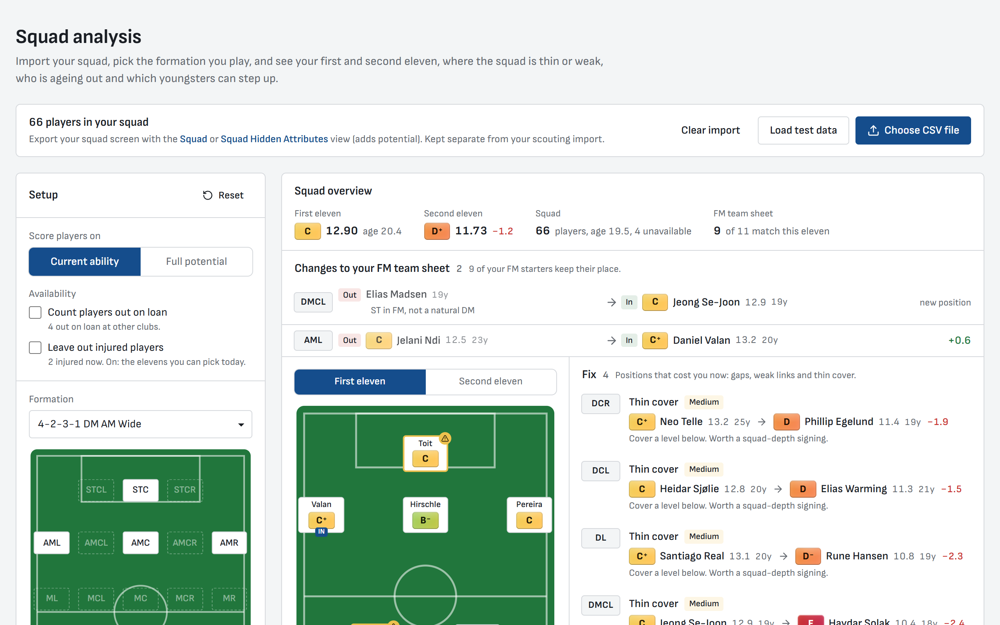
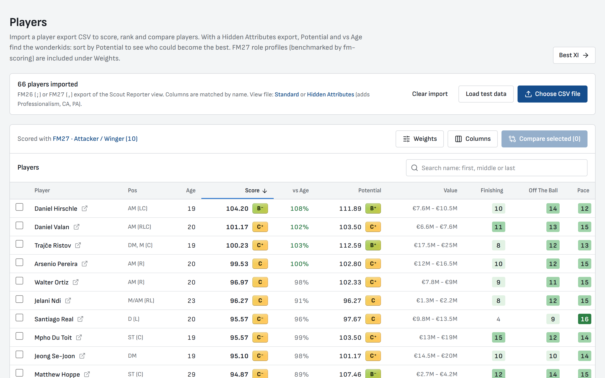
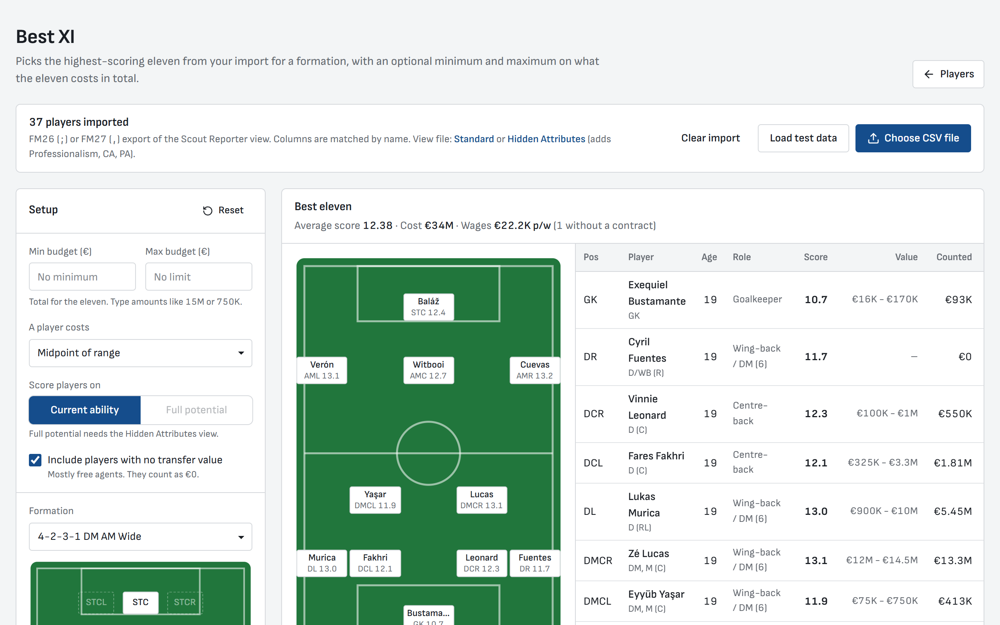
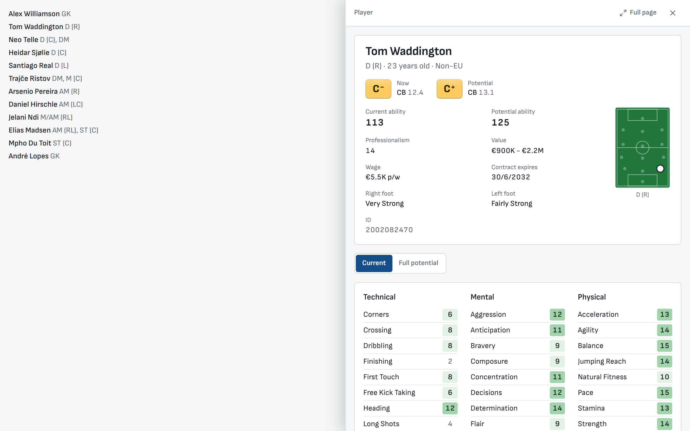
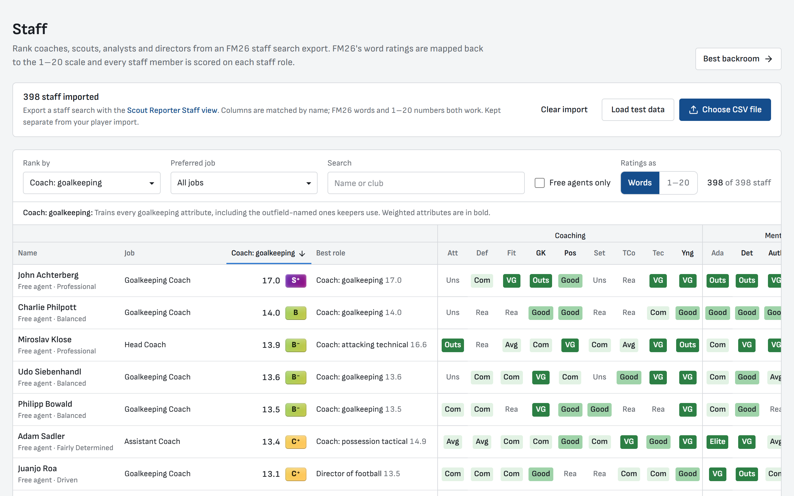
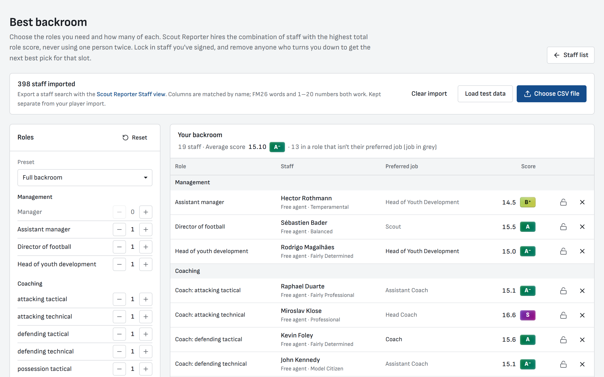

# Scout Reporter

Scouting tools for **Football Manager 27 and 26**. Import a player export from FM, or scan the game
directly with the desktop app, and rank players on weighted attributes and FM27 benchmark roles.

**Website:** [fmscouting.sebastianfoder.com](https://fmscouting.sebastianfoder.com) ·
**Desktop app:** [download for Windows](https://fmscouting.sebastianfoder.com/download)

<picture><source media="(prefers-color-scheme: dark)" srcset="apps/web/public/screenshots/squad-dark.png"></picture>

## What it does

- **Players**: scores from your own attribute weights or the FM27 benchmark roles
  (from [jamiebolden/fm-scoring](https://github.com/jamiebolden/fm-scoring)), a vs-age column, a
  development plan per player and a side-by-side compare. With CA and PA, a Potential score
  estimates each player at full potential, to find wonderkids.
- **Best XI** (a button on Players): the best eleven for a formation, with an optional transfer budget
- **Squad analysis**: your first and second eleven, gaps, weak spots, ageing starters and upgrades from your scouting
- **Staff**: staff scored on 17 roles, with **Best backroom** to pick the best combination to hire
- **Growth** (desktop): CA, PA and attribute changes between two scans of your save

The website reads CSV exports made with the views in `apps/web/public/*.fmf`; the site's
[How to use](https://fmscouting.sebastianfoder.com/how-to-use) page walks through it. Everything runs
in the browser: the CSV never leaves your machine.

<table>
<tr>
<td colspan="2"><picture><source media="(prefers-color-scheme: dark)" srcset="apps/web/public/screenshots/players-dark.png"></picture><br><b>Player list</b>: scores on your weights or an FM27 role, with Potential</td>
</tr>
<tr>
<td width="50%"><picture><source media="(prefers-color-scheme: dark)" srcset="apps/web/public/screenshots/best-xi-dark.png"></picture><br><b>Best XI</b>: the best eleven for a formation, within a budget</td>
<td width="50%"><picture><source media="(prefers-color-scheme: dark)" srcset="apps/web/public/screenshots/player-dark.png"></picture><br><b>Player panel</b>: click any player for their profile</td>
</tr>
<tr>
<td width="50%"><picture><source media="(prefers-color-scheme: dark)" srcset="apps/web/public/screenshots/staff-dark.png"></picture><br><b>Staff</b>: scored on 17 staff roles</td>
<td width="50%"><picture><source media="(prefers-color-scheme: dark)" srcset="apps/web/public/screenshots/backroom-dark.png"></picture><br><b>Best backroom</b>: the staff to hire for every role</td>
</tr>
</table>

The screenshots are made from Storybook with `bun run screenshots` (sample data, light and dark).

## Desktop app (Windows)

The desktop app has every screen of the website, plus **Scan FM**: open a Player Search (or Staff
Search) in a running FM, press **F9**, and the players it found, with your own club, are in the app
a couple of seconds later. No view or CSV export needed, and it includes real CA, PA and hidden
attributes (one switch turns those off). It only reads FM's memory; it never changes the game or
your save.

- **Install:** download `Scout-Reporter-Setup-<version>.exe` from the
  [download page](https://fmscouting.sebastianfoder.com/download) or the
  [desktop releases](https://github.com/SebastianFoder/fm-scoutreporter/releases?q=%22Scout+Reporter+desktop%22&expanded=true).
  It is not code-signed yet, so SmartScreen warns on first run: **More info** > **Run anyway**.
- **Supported:** FM27 (27.0) and FM26 (26.3) on Windows, from Steam, Epic or Game Pass. A big FM
  patch can move the data the reader looks for; the app warns when the game version differs. Mac is
  planned.
- **Updates:** the app tells you when a new version is out; **Update now** downloads it, checks its
  SHA-256 and installs it. Settings, scans, weights and formations are kept.
- Scans are stored under `%APPDATA%\Scout Reporter\scans`.

## Development

Needs [Bun](https://bun.sh); the desktop reader also needs the .NET 10 SDK.

```bash
bun install
bun dev                  # website on http://localhost:3000
bun run test             # tests in every workspace
bun run lint
bun run storybook        # components on http://localhost:6006

bun run reader:build     # the memory reader: reader/dist/ScoutReporter.Reader.exe
bun run desktop:dev      # desktop app with hot-reloading pages
bun run desktop:dist     # Windows installer in apps/desktop/release
```

| Path | What |
|------|------|
| `apps/web` | Next.js website, also the desktop app's pages (built with `SCOUTREPORTER_TARGET=desktop`) |
| `apps/desktop` | Electron app: window, scanning, scan storage (SQLite) |
| `packages/core` | Shared logic: CSV parsing, scoring, roles and potential, Best XI, squad, staff, scan format |
| `packages/ui` | Shared React components and screens, styles and Storybook |
| `reader` | C# memory reader for FM ([README](reader/README.md), [re-pinning after a patch](reader/REPIN.md), [speed](reader/PERFORMANCE.md)) |

## Releases

- **Website:** [semantic-release](https://github.com/semantic-release/semantic-release) publishes a
  release (`vX.Y.Z`, `CHANGELOG.md`) when `feat:` or `fix:` commits land on `master`, so use
  [Conventional Commits](https://www.conventionalcommits.org/).
- **Desktop:** released by hand. Run **Actions > Desktop release > Run workflow** with a version, or
  `gh workflow run desktop-release.yml -f version=0.2.0`. It tags `desktop-v0.2.0`, tests, builds
  and smoke-tests the installer and publishes it with a checksum. Pushing a `desktop-v*` tag also
  works, except on a `[skip ci]` commit.

## Credits

The reader is adapted from [FMSuperScout](https://github.com/mavarobli/FMSuperScout) by mavarobli
(MIT, see `reader/LICENSE-FMSuperScout`). FM27 weights, age benchmarks and training research come
from [jamiebolden/fm-scoring](https://github.com/jamiebolden/fm-scoring).
